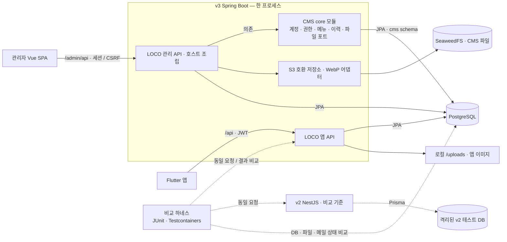

# LOCO — 지도 공유 서비스의 서버 이관과 동시성·성능 검증

## 한눈에 보기

- **Flutter 앱 무수정 NestJS→Spring 이관** — v2와 응답·DB를 자동 비교하는 테스트 **1,152건**. [검증 기록](apps/server-v3/CMS_PR_DRAFT.md)
- **동시성 버그 재현·수정** — v2의 사진 장수 제한 우회·깨진 이미지를 수정하고, CMS 메뉴의 동시 이동에서 순환도 재현해 방지. [이미지](apps/server-v3/IMAGE_API_DESIGN.md) · [메뉴](apps/server-v3/CMS_CORE_DESIGN.md)
- **지도를 넓게 볼 때 p95 111→21ms(−81%)** — 지도방 전체 조회 시 재현되던 서버 메모리 부족(OOM) 제거. [성능 실험 결과][p2]
- **서비스와 분리된 재사용형 관리자 CMS** — 권한·메뉴 트리·변경 이력·파일 관리. [구현 범위](apps/server-v3/CMS_PR_DRAFT.md)

사용자는 지도방에 장소·사진·리뷰를 남기고 다른 사람과 공유합니다. 기존 NestJS·Prisma 서버(v2)의 응답·인증·DB 상태를 기준으로 Spring 서버(v3)를 만들었습니다. 의도적으로 바꾼 동작은 결정 기록과 비교 테스트의 **알려진 차이**로 관리합니다. 이후 서비스에 종속되지 않는 CMS core와 LOCO 운영 화면을 추가했습니다. [이관 배경·범위](apps/server-v3/MIGRATION_SUMMARY.md) · [CMS 구현 범위](apps/server-v3/CMS_PR_DRAFT.md)

**구현 상태:** `main`에는 v3 이관과 CMS가 포함되어 있습니다. 아래 P2 성능·셀 갱신 결과는 **아직 main에 병합하지 않은 `feature/perf-stage2`의 실험 결과**이며 고정 커밋의 근거로 연결합니다. P3 공간 인덱스는 준비 단계로, 성능 성과에 포함하지 않습니다. [P2 마감][p2-close] · [P3 준비 상태][p3]

## 아키텍처



CMS core는 LOCO 타입과 S3 SDK·libvips를 모릅니다. 호스트가 포트 구현과 업무 기능을 조립하며, 앱 JWT와 관리자 세션은 서로 인증 수단으로 인정하지 않습니다. 하네스는 v2·v3 DB를 분리해 같은 시드와 요청을 비교합니다. 개발 Compose의 공유 DB 구성과는 구별합니다. [모듈 경계](apps/server-v3/CMS_CORE_DESIGN.md) · [비교 하네스](apps/server-v3/COMPARISON_TESTS.md)

## 핵심 성과와 검증 근거

### 이관·개발 생산성

| 과제 | 확인한 결과 | 근거 |
| --- | --- | --- |
| 앱을 바꾸지 않는 서버 이관 | 응답·DB·파일·메일 비교, **v2 비교 1,152건 성공** | [비교 방법](apps/server-v3/COMPARISON_TESTS.md) · [검증 결과](apps/server-v3/CMS_PR_DRAFT.md) |
| 전체 검증·의도된 차이 관리 | 서버 **1,642건 중 1,641 성공·실패 0·HEIC 건너뜀 1**. 알려진 차이 **11건: 개선 6·의도 5·보류 0** | [검증 범위·결과](apps/server-v3/CMS_PR_DRAFT.md) |
| 불필요한 v2 재시작 제거 | 초기 비교 테스트 최적화 당시 **1262→468초**, 기존 케이스 누락 없음 | [측정 조건·전후 기록](apps/server-v3/TEST_PERFORMANCE.md) |
| 멤버 목록 N+1 제거 | 멤버 10명에서 **13→3 SQL**, 이후 쿼리 수 증가를 테스트로 감지 | [측정·구현](apps/server-v3/MAP_API_DESIGN.md) |

개선 차이는 이미지 경쟁·중복 가입·교체된 FCM 토큰 보존 등 정합성 수정입니다. 의도 차이는 초대 코드 생성·외부 오류 메시지·타임아웃·예약 시간대·런타임 헤더 정책입니다. [알려진 차이 전체 목록](apps/server-v3/MIGRATION_SUMMARY.md). P2 실험에서는 별도 승인으로 **16건(개선 10·의도 6)**이 되었으며 main의 수치와 섞지 않습니다. [P2 검증][p2-design]

### 동시성: 조건의 범위에 맞춰 제어 방식 선택

| 사례 | 선택한 방식 | 실제 DB·HTTP에서 확인한 결과 |
| --- | --- | --- |
| 장소 이미지 최대 3장 | 장수 조건을 검사하는 조건부 UPDATE | 초기 **2장에 동시 업로드 8건 → v2 10장, v3 3장**. [재현·검증](apps/server-v3/IMAGE_API_DESIGN.md) |
| CMS 파일 업로드와 정리 경합 | 현재 상태를 검사하는 조건부 UPDATE | 업로드 완료로 공개된 파일의 **실제 객체 누락 0**. [C-23·검증](apps/server-v3/CMS_CORE_DESIGN.md) |
| 두 관리자의 같은 신고 처리 | 조건부 UPDATE와 변경 이력을 함께 커밋 | 초기 처리·종결 경쟁 각각 **20회**, 매회 성공 **1**·충돌 **1**, 덮어쓰기·추가 이력 **0**. [C-45·실측](apps/server-v3/REPORT_PROCESSING_DESIGN.md) |
| 메뉴의 동시 교차 이동 | **비관적 락 + 변경 버전 확인** | **5/5회 순환 → 0/5회**. 이동해도 자신·자손의 ID와 권한·이력 참조 유지. [C-9-2·검증](apps/server-v3/CMS_CORE_DESIGN.md) |
| 지도 집계 교착·오래된 집계 — P2 | 지도방·집계 단위별 **advisory lock** 획득 후 갱신 | 교차 이동 모두 성공·**교착 0**. 동시 생성 **2/4/8/16건**의 최종 집계 정확·오래된 집계 **0**. [E-22·실측][p2-design] |

한 행의 조건은 조건부 UPDATE, 여러 행에 걸친 메뉴 관계는 비관적 락으로 다뤘습니다. 조건부 UPDATE도 DB 내부 행 잠금을 사용합니다. 위 수치는 동시 요청의 **정합성 검증**이며 잠금 방식의 성능 우열을 뜻하지 않습니다. [판단 기준·재현 조건](apps/server-v3/REPORT_PROCESSING_DESIGN.md) · [E-22 전환 주의][p2-design]

### 성능 실험 — P2 읽기 채택, 쓰기 정량 판정 보류

| 조건 | 결과 | 판정·근거 |
| --- | --- | --- |
| 지도를 넓게 볼 때 | 개선 전/후 p95 **111→21ms(−81%)** | [측정 조건·집계 정의·결과][p2] |
| 지도를 좁게 볼 때 | 기존 기준 대비 p95 **−0.205%**, p99 **+0.869%**. 회귀 기준 통과 | [읽기 결과][p2] |
| 지도방 전체를 볼 때 | **메모리 부족(OOM) 발생 → 검사 3회 OOM 0**, 오류·요청 누락 0. 힙 증설 없음 | [이전 실패][p0] · [개선 결과][p2] |
| 생성·이동·삭제 쓰기 | **개선 방향 확인, 정량 판정 보류** | [간섭 원인·최종 판정][p2-close] |

## 측정 방법론과 한계

- **결과 전에 기준 고정:** 같은 세션에서 개선 전/후 실행 순서를 번갈아 비교합니다(AB/BA). 코드·데이터·메모리·부하·판정 기준을 먼저 고정하고 결과 뒤에 바꾸지 않습니다. [프로토콜·실행 기록][p2]
- **비교 환경 고정:** 응답 시간·SQL·CPU·메모리·실행 계획을 측정하고 환경 기록, 커밋·실행 파일 식별값과 [압축 원본](https://github.com/MycroCosmo/loco/releases/tag/perf-stage2-p2-20261109-formal)을 함께 남깁니다. [환경·집계 정의][p2]
- **간섭·오류 회차는 무효:** 사전 규칙에 따라 원본을 보존하고 임의 대체·제외하지 않습니다. 쓰기 표본 수·판정 규칙 변경은 다음 세션 전에 승인·고정했으며 이전 실패에 소급 적용하지 않았습니다. [E-24 이력·한계][p2-close]
- **노트북 상대 비교이며 운영 절대 수치가 아닙니다.** OS·다른 프로세스의 간섭 한계가 있습니다. 실제 외부 API 성공·AWS 운영 용량도 이 결과로 주장하지 않습니다. [측정 한계][p2] · [외부 대역 검증 범위](apps/server-v3/MIGRATION_SUMMARY.md)

## 기술 스택과 주요 결정

| 영역 | 기술·결정 | 이유·기록 |
| --- | --- | --- |
| 서버·데이터 | Java 21 · Spring Boot 3.5 · Gradle · JPA · PostgreSQL 17 · Flyway | v2 UUID 문자열·초기 스키마 보존, JPA 단일 접근. [빌드](apps/server-v3/build.gradle), [0번 묶음 결정](apps/server-v3/README.md) |
| CMS 경계·권한 | Gradle 멀티 모듈, READ/MANAGE, 서버 세션·CSRF | 서비스 독립 모듈과 단순한 조회/관리 권한. [C-1·C-3·C-4·C-11](apps/server-v3/CMS_CORE_DESIGN.md) |
| 파일·이력 | SeaweedFS · AWS SDK v2 · libvips · PostgreSQL JSONB | 업무 변경과 이력 원자적 저장. 비밀값·메모 원문 수집 제한. [C-15·C-20·C-23](apps/server-v3/CMS_CORE_DESIGN.md) · [C-46·C-48](apps/server-v3/REPORT_PROCESSING_DESIGN.md) |
| 화면 | Flutter 앱 유지 · Vue 3/Vite/TypeScript 관리자 SPA | 서버 렌더링 없이 Spring에서 정적 제공. [C-5·C-24~32](apps/server-v3/ADMIN_UI_DESIGN.md) |
| 검증·측정 | JUnit 5 · Testcontainers · Mailpit · Vitest · Playwright · k6 | 정합성 검증과 성능 측정을 구분. [E-16·E-21·E-22][p2-design] · [E-24 최종 판정][p2-close] |

## 로컬 실행

Docker Compose를 사용하며 명령은 저장소 루트에서 실행합니다. `.env`가 없다면 [`.env.example`](.env.example)을 복사하고 아래 키에 **로컬용 값**을 넣습니다. 기존 `.env`는 덮어쓰지 않습니다.

| 용도 | 필요한 `.env` 키 |
| --- | --- |
| 필수 DB·앱 인증 | `DB_USERNAME`, `DB_PASSWORD`, `JWT_SECRET` |
| 필수 로컬 객체 저장소 | `CMS_STORAGE_ACCESS_KEY`, `CMS_STORAGE_SECRET_KEY` |
| 관리자 초기 생성 시 | `CMS_BOOTSTRAP_PASSWORD` |

```powershell
if (-not (Test-Path .env)) { Copy-Item .env.example .env }
# 위 필수 키를 채운 다음 실행
docker compose config --quiet
docker compose up --build --detach --wait --wait-timeout 180
docker compose ps
curl.exe http://localhost:8081/api/health
```

v3 API는 `http://localhost:8081/api`, 관리자 화면은 `http://localhost:8081/admin/`, 로컬 메일함은 `http://localhost:8025`입니다. Compose는 PostgreSQL·SeaweedFS·Mailpit·v3·비교 기준 v2를 기동하며 스키마는 v3 Flyway가 관리합니다. [실제 Compose 설정](compose.yaml)

관리자 계정은 앱 기동 후 [일회성 CLI](apps/server-v3/CMS_CORE_DESIGN.md)로 만들고 첫 로그인에서 비밀번호를 변경합니다. 비밀번호를 명령줄 인자로 넘기지 않습니다. 로컬 객체 저장소에는 실제 AWS 키가 필요하지 않으며, 메일은 기본 Mailpit으로 갑니다. Kakao·FCM·외부 OAuth는 별도 설정이 필요합니다. Flutter 연결과 외부 키 없이 확인할 화면은 [수동 확인 체크리스트](apps/server-v3/FLUTTER_SMOKE_TEST.md)를 참고하세요.

개발 Compose는 로컬 검증용입니다. v2·v3의 이미지 쓰기를 같은 DB에 섞으면 v3의 동시성 보장을 유지할 수 없습니다. 전환 주의사항과 테스트 명령은 [v3 실행·검증 안내](apps/server-v3/README.md), 관리자 화면 개발은 [admin 안내](apps/admin/README.md)에 있습니다.

[p2]: https://github.com/MycroCosmo/loco/blob/8f2c07cef0fcb4dfc276d560deaedc76ba1a2fa2/perf/stage2/P2_RESULTS.md
[p2-close]: https://github.com/MycroCosmo/loco/blob/8f2c07cef0fcb4dfc276d560deaedc76ba1a2fa2/perf/stage2/P2_WRITE_E24.md
[p2-design]: https://github.com/MycroCosmo/loco/blob/8f2c07cef0fcb4dfc276d560deaedc76ba1a2fa2/apps/server-v3/PERF_STAGE2_P2_DESIGN.md
[p0]: https://github.com/MycroCosmo/loco/blob/8f2c07cef0fcb4dfc276d560deaedc76ba1a2fa2/perf/stage2/P0_RESULTS.md
[p3]: https://github.com/MycroCosmo/loco/blob/061bd5ee5d985dc77993093737b407143931e3d4/apps/server-v3/PERF_STAGE2_P3_DESIGN.md
